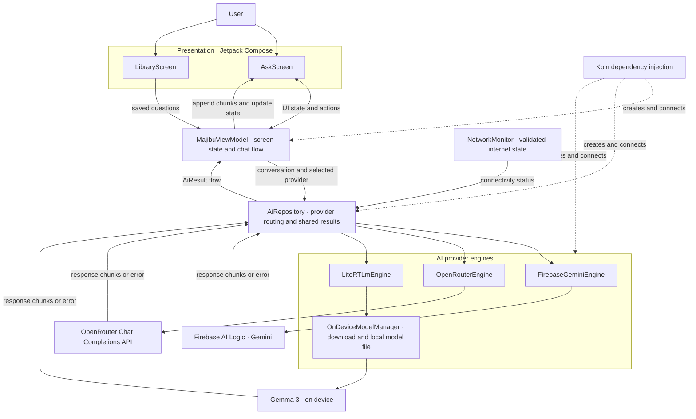

# Majibu AI 
 ## One assistant. Multiple AI engines. Online or offline.

MajibuAI is a native Android hybrid AI assistant built with Kotlin and Jetpack Compose. It explores how cloud-based and on-device language models can work together to deliver a flexible AI experience across different connectivity conditions.

The application integrates Google Gemini, OpenRouter, and on-device Gemma through a shared AI architecture, with streaming responses, provider selection, and fallback between available inference engines.

Rather than depending on a single AI provider, MajibuAI demonstrates how Android applications can orchestrate multiple AI models and make AI experiences more adaptable to the device and network environment.

 ## Why MajibuAI?

Cloud AI offers access to powerful models, but it depends on network connectivity and remote services. On-device AI offers local inference and greater independence from connectivity, but introduces constraints around model size, memory, and device performance.

MajibuAI explores the engineering challenges of bringing these approaches together in one Android application.

 ## Features

Multiple AI providers: Integrates Gemini through Firebase AI Logic, OpenRouter, and local Gemma.

Hybrid inference: Supports cloud and on-device execution, including fallback between providers.

On-device AI: Runs Gemma 3 1B using LiteRT-LM.

Streaming responses: Uses Kotlin Flow to deliver generated response chunks incrementally.

Network awareness: Monitors connectivity to inform hybrid inference decisions.

Model management: Downloads and initializes the on-device model when needed.

Provider selection: Allows users to select an AI execution option.

Response library: Save useful questions and answers for later access during the app session.


## Language and technologies

- **Language:** Kotlin
- **UI:** Jetpack Compose and Material 3
- **Architecture:** MVVM with Kotlin Coroutines and Flow
- **Dependency injection:** Koin
- **AI:** Firebase AI Logic, OpenRouter, and on-device LiteRT-LM

## App demo


## Project structure

```text
MajibuAI/
├── app/
│   └── src/
│       ├── main/
│       │   ├── java/com/valentinerutto/majibuai/
│       │   │   ├── data/ai/          # Repository, provider engines, and AI models
│       │   │   ├── di/               # Koin dependency-injection module
│       │   │   ├── navigation/       # Compose navigation and bottom bar
│       │   │   ├── network/          # Retrofit and OkHttp setup
│       │   │   ├── ui/               # ViewModel, screens, and theme
│       │   │   ├── util/             # Provider, network, and app constants
│       │   │   ├── MainActivity.kt
│       │   │   └── MajibuApp.kt
│       │   └── res/                  # App icons, images, fonts, and themes
│       ├── test/                     # Local unit tests
│       └── androidTest/              # Instrumented Android tests
├── assets/                           # README demo media
├── docs/                             # Setup guide and codelab
├── gradle/
│   └── libs.versions.toml            # Central dependency versions and aliases
├── build.gradle.kts
├── settings.gradle.kts
└── README.md
```

## Architecture

MajibuAI keeps the chat UI independent from the AI provider APIs. The Ask screen sends user actions to a shared ViewModel, which passes the conversation and selected provider to the repository. The repository routes requests to the provider engine and returns streamed results and typed errors through a common flow.



## User flow

1. The user opens **Ask**, chooses Firebase, OpenRouter, On-device, or Hybrid, and enters a question.
2. The ViewModel adds the question to the conversation and asks `AiRepository` to handle it. Provider engines stream answer chunks back into the same assistant message.
3. With **Hybrid**, the repository checks for validated internet. It tries Firebase, then OpenRouter if the first provider fails before producing text. If no cloud answer is available, it uses the on-device model when ready. If a stream has already started and then fails, the partial answer stays visible and the user can retry.
4. The first time the user selects **On-device**, the app asks before downloading the model. It shows download progress, initializes LiteRT-LM, then generates locally.
5. The user can save a completed question and answer, then find it in **Library**.

Saved questions are currently held in ViewModel state for the running app session.
