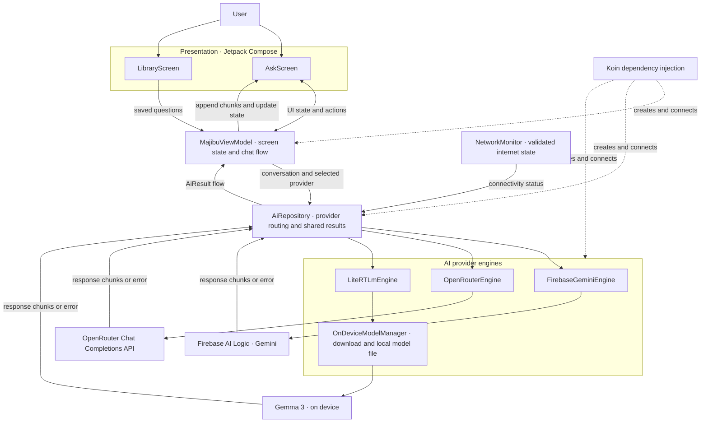

# Majibu AI 
## Ask. Understand. Remember.
An AI-powered conference and study companion that helps you understand unfamiliar concepts, capture questions, and organize knowledge for later.

## Language and technologies

- **Language:** Kotlin
- **UI:** Jetpack Compose and Material 3
- **Architecture:** MVVM with Kotlin Coroutines and Flow
- **Dependency injection:** Koin
- **AI:** Firebase AI Logic, OpenRouter, and on-device LiteRT-LM

## App demo

## Architecture

MajibuAI keeps the chat UI independent from the AI provider APIs. The Ask screen sends user actions to a shared ViewModel, which passes the conversation and selected provider to the repository. The repository routes requests to the provider engine and returns streamed results and typed errors through a common flow.

## User flow

1. The user opens **Ask**, chooses Firebase, OpenRouter, On-device, or Hybrid, and enters a question.
2. The ViewModel adds the question to the conversation and asks `AiRepository` to handle it. Provider engines stream answer chunks back into the same assistant message.
3. With **Hybrid**, the repository checks for validated internet. It tries Firebase, then OpenRouter if the first provider fails before producing text. If no cloud answer is available, it uses the on-device model when ready. If a stream has already started and then fails, the partial answer stays visible and the user can retry.
4. The first time the user selects **On-device**, the app asks before downloading the model. It shows download progress, initializes LiteRT-LM, then generates locally.
5. The user can save a completed question and answer, then find it in **Library**.

Saved questions are currently held in ViewModel state for the running app session.
